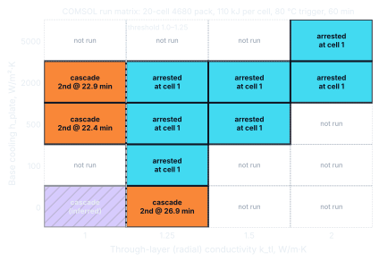
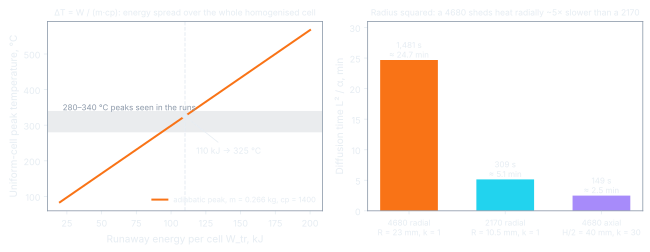
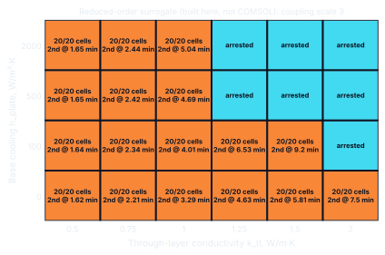
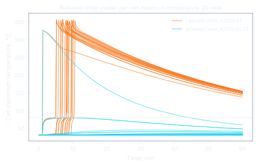

<p align="center"><a href="https://soham-cheme.github.io/4680-Thermal-Runaway-Propagation-COMSOL/"></a></p>

<p align="center"><b><a href="https://soham-cheme.github.io/4680-Thermal-Runaway-Propagation-COMSOL/">Open the live page</a></b> · the 20-cell pack in 3D with the cascade playing, a conductivity slider that flips it from cascade to arrest, the run matrix as a 3D tile field, and every figure as a scroll-driven 3D scene</p>

<div align="center">

[](https://www.comsol.com/model/thermal-runaway-propagation-in-a-battery-pack-107571)
[](#the-run-matrix)
[](#the-threshold)
[](#reproduce)

**Soham Kavathekar** · independent project · COMSOL Multiphysics 6.4, Battery Design Module, transient electro-thermal FEA

</div>

---

## Results first

**Built** a 20-cell pack of 4680-format cells in COMSOL Multiphysics 6.4 on the validated Application Library model *Thermal Runaway Propagation in a Battery Pack*, resized to 46 × 80 mm cells, 25 Ah and 110 kJ of runaway energy per cell. One cell is forced into runaway at one minute; any other cell triggers when its maximum temperature crosses 80 °C.

**Identified** a sharp cascade threshold in the cell's through-layer (radial) thermal conductivity between 1.0 and 1.25 W/m·K across twelve transient one-hour studies: below it about 13 of the 20 cells failed within the hour; above it propagation stopped at the initiating cell.

**Showed** that the threshold is a property of the cell, not the cooling: it did not move for any base cooling from 100 to 2,000 W/m²·K, and only removing the heat sink entirely brought the cascade back at 1.25 W/m·K (the adiabatic stress test).

**Diagnosed** the controlling resistance. A 100× change in the cap contact resistance moved the onset of propagation by about 20 s out of 23 min, because the acrylic pack floor and the cell interior, not the base contact, set the pace of heat removal. That diagnosis is what redirected the study to internal conduction and located the threshold.

**Reproduced** the threshold at h = 500 and 2,000 and the adiabatic flip with a reduced-order thermal network built in this repository, and **validated** every scaling argument behind the numbers with tested Python.

## What was asked

The tabless 4680 is usually discussed electrically: lower internal resistance, better fast charging. The question here was whether anything about the format changes **thermal runaway propagation** between cells in a pack, and, more usefully, which thermal resistance controls whether failure spreads.

## What was built

Base model: COMSOL Application Library, *Thermal Runaway Propagation in a Battery Pack* (Application ID 107571, Battery Design Module), which couples a lumped Battery Pack interface, Heat Transfer in Solids and Electrochemical Heating, built on the validated COMSOL pack-propagation model of Coman, Darcy and White, *J. Electrochem. Soc.* 169, 040516 (2022). The model was adapted to the 4680 format:

| Item | Value | Note |
|---|---|---|
| Pack | 20 cells, 5s4p, 2 mm gaps, acrylic holders, steel AISI 4340 connectors, air compartment, plastic wrap | stock layout |
| Cell | 46 × 80 mm homogenised cylinder | volume 1.33 × 10⁻⁴ m³, mass ≈ 0.27 kg at 2,000 kg/m³ |
| Thermal properties | ρ = 2,000 kg/m³, c<sub>p</sub> = 1,400 J/kg·K, in-layer k = 30 W/m·K, through-layer k = 1 W/m·K (stock) | spirally wound Battery Layers node |
| Electrical | 25 Ah per cell (100 A at 1C for the four parallel strings), 2C charge from 25 % SOC, 21 V pack cut-off, η<sub>1C</sub> = 4.5 mV | lumped battery model |
| Runaway | Thermal Event: triangular pulse, peak 36,667 W at t = 1 s, ends at 6 s, total 110 kJ; ohmic resistance up about 100× after the event | energy mass-scaled from the stock cell |
| Trigger | cell 1 forced at t = 1 min; any other cell triggers when its **maximum** temperature exceeds 80 °C | step trigger |
| Cooling | ambient 10 W/m²·K at 30 °C on all boundaries; a cooled base (pack floor) with h<sub>eff</sub> = 1 / (1/h<sub>plate</sub> + R<sub>cap</sub>) | bottom-cooled pack, the standard pack-scale representation |
| Mesh | 291,236 domain elements, 231 domains, 1,588 boundaries, about 2.7 GB | swept mesh through the cylinders |
| Study | time-dependent, 60 min, output every 5 min, first step 0.1 s | |

**Scope and assumptions.** Cells are homogenised anisotropic solids with a prescribed 110 kJ release and a step trigger at 80 °C, the standard pack-scale representation; heat crosses between cells by conduction through the air gap, the acrylic holders and the steel connectors; cooling is applied at the pack floor.

**Swept parameter, stated precisely.** In COMSOL's spirally wound Battery Layers node, `kT_batt_tl` is the *through-layer* conductivity: across the windings, the **radial** direction in a cylindrical cell (stock 1 W/m·K). `kT_batt_il`, the *in-layer* conductivity along the foils (azimuthal and axial, stock 30 W/m·K), was held fixed. The sweep varied the through-layer value; tabless construction itself changes how the foil edges meet the cap, which is a separate lever.

## The run matrix

Rows are base cooling h<sub>plate</sub> (W/m²·K), columns are through-layer conductivity k<sub>tl</sub> (W/m·K). All cases: R<sub>cap</sub> = 10⁻⁵ m²·K/W, 110 kJ per cell, 25 Ah. **Bold** cells cascaded. Generated from `results/matrix.json` by `python -m analysis.matrix`; on the live page the same matrix is a 3D tile field that lifts the runs each phase added.

| Base cooling h (W/m²·K) | k_tl = 1 | k_tl = 1.25 | k_tl = 1.5 | k_tl = 2 |
|---|---|---|---|---|
| 0 | **Cascade**<sup>†</sup> | **Cascade (2nd ignition ≈ 26.9 min)** | — | — |
| 100 | — | Arrested at cell 1 | — | — |
| 500 | **Cascade (2nd ignition ≈ 22.4 min)** | Arrested at cell 1 | Arrested at cell 1 | — |
| 2000 | **Cascade (2nd ignition ≈ 22.9 min)** | Arrested at cell 1 | Arrested at cell 1 | Arrested at cell 1 |
| 5000 | — | — | — | Arrested at cell 1 |

<sup>†</sup> inferred from the neighbouring runs.

<p align="center"></p>

## The threshold

- At h<sub>plate</sub> = 2,000: k<sub>tl</sub> = 1.0 cascaded (second ignition at 22.9 min); 1.25, 1.5 and 2.0 stopped at cell 1. A 25 % change in internal conductivity flipped the outcome.
- At h<sub>plate</sub> = 500: the same threshold (1.0 cascaded at 22.4 min; 1.25 and 1.5 stopped). The threshold is a property of the cell, not a cooling artefact.
- **Cascade pace** (k<sub>tl</sub> = 1.0, h = 2,000): about 13 further ignitions between about 23 and 52 min, roughly 0.45 cells per minute after onset, read from the pack-maximum and pack-average temperature probes.
- **Mechanism.** A neighbour triggers when its *maximum* temperature crosses 80 °C, and that maximum sits on the skin facing the burning cell. With low through-layer conductivity the arriving heat piles up at that skin; with higher conductivity it spreads into the interior and down to the cooled base, and the local maximum stays below 80 °C. The step trigger makes the transition sharp, the same tipping behaviour as a thermal-explosion threshold.

## The adiabatic stress test

At the threshold value k<sub>tl</sub> = 1.25: **h<sub>plate</sub> = 0 cascaded** (second ignition at about 26.9 min, pack average about 260 °C at 61 min) and **h<sub>plate</sub> = 100 arrested**. Near the threshold a cell needs both an internal conduction path and a heat sink, and above about 100 W/m²·K more cooling does not move the threshold. The Biot number says why: with L = 23 mm and k = 1 W/m·K, h = 100 gives Bi ≈ 2.3, h = 500 gives 11.5 and h = 2,000 gives 46. Internal conduction is the bottleneck well before the plate is.

## The controlling resistance: a positive null result

The first representation of tabless was a lower thermal contact resistance at the cell base, R<sub>cap</sub> = 10⁻³ (tabbed) against 10⁻⁵ m²·K/W (tabless), in h<sub>eff</sub> = 1/(1/h<sub>plate</sub> + R<sub>cap</sub>) on the pack floor with h<sub>plate</sub> = 2,000 (h<sub>eff</sub> = 667 against 1,961 W/m²·K). The second ignition moved from 22.6 to 22.9 min: a **100× change produced about 20 s out of 23 min**. Diagnosis: the cooled boundary is the pack enclosure floor, behind a few millimetres of acrylic holder (k ≈ 0.19 W/m·K, roughly 5 × 10⁻³ to 10⁻² m²·K/W), which is larger than the tabbed contact resistance and swamps the difference. An earlier sweep of the stock pack's ohmic overpotential (9.0 → 1.0 mV) moved the second-ignition delay only from 6.7 to 7.2 min, small and saturating. Neither the electrical nor the base-contact representation of tabless is first-order in a bottom-cooled pack: **the cell's own through-layer conduction is the controlling resistance**, which is the finding the rest of the study is built on.

## Scaling arguments (reproduced in `analysis/scaling.py`)

| Check | Result | Test |
|---|---|---|
| Adiabatic temperature rise, 110 kJ into 0.266 kg at 1,400 J/kg·K | ΔT ≈ 295 K, about 325 °C, inside the 280 to 340 °C band of peaks seen in the runs | `test_adiabatic_rise_about_295_K` |
| Radial diffusion time R²/α with k = 1 (α ≈ 3.6 × 10⁻⁷ m²/s) | 4680 (R = 23 mm) ≈ 1,470 s, about 25 min; 21700 (R = 10.5 mm) ≈ 306 s, about 5 min: about 5× slower radial heat removal | `test_diffusion_times_match_note` |
| Axial diffusion time with k = 30 over the 40 mm half-height | ≈ 150 s, about 10× faster than radial | same |
| Biot number, L = 23 mm, k = 1 | h = 100 → 2.3; 500 → 11.5; 2,000 → 46 | `test_biot_numbers` |
| Mass scaling of runaway energy | the 46 × 80 mm cell has 5.5× the volume of the 21 × 70 mm stock cell; 20 to 30 kJ × 5.5 brackets 110 to 165 kJ; the study used 110 kJ | `test_mass_scaling_bracket` |

<p align="center"></p>

## Reduced-order model (built here)

`analysis/lumped.py` is a transparent thermal network of the same pack: each cell is a core plus five radial shells split into 16 azimuthal sectors (radial links use k<sub>tl</sub>, azimuthal links use k<sub>il</sub>), neighbours are coupled through still air (two-cylinder conduction shape factor), acrylic holder bridges and steel connector strips, the cells sit in a wrapped air compartment that loses heat to ambient at 10 W/m²·K, and the base cooling acts on each cell's footprint through the half-height axial path, a 3 mm acrylic floor and 1/h<sub>eff</sub>. Same 110 kJ six-second pulse, same 80 °C maximum-temperature trigger, cell 1 forced at 1 min, explicit time stepping at 0.1 s for 60 min, about one second per run.

The inter-cell coupling is calibrated once (×3.0) so that the network matches the COMSOL threshold at h = 2,000. **The reduced-order model then agrees with the COMSOL threshold at h = 500 and 2,000 and reproduces the adiabatic flip at k = 1.25**, gives the same monotone fall of the neighbour's peak temperature with k<sub>tl</sub>, and confirms that base contact resistance is second-order behind the acrylic floor (a 100× change in R<sub>cap</sub> moves the neighbour's peak by under 0.5 K). Its 24-run sweep, its twenty per-cell traces and the hero animation on the live page come from this model. Scope: it is a reading aid for the finite-element result, built for trends and mechanism rather than absolute timing; the full comparison, including where it differs, is in [`docs/CLAIMS.md`](docs/CLAIMS.md).

| Question | COMSOL | Reduced-order model |
|---|---|---|
| Threshold at h = 2,000 (calibration point) | cascade at 1.0, arrested at 1.25 | cascade at 1.0, arrested at 1.25 |
| Threshold at h = 500 | between 1.0 and 1.25 | between 1.0 and 1.25 |
| k = 1.25 with no cooling (h = 0) | cascade | cascade |
| Neighbour peak temperature against k<sub>tl</sub> | falls as k<sub>tl</sub> rises | falls monotonically |
| 100× change in R<sub>cap</sub> at h = 2,000 | about 20 s out of 23 min | neighbour peak moves by under 0.5 K |

<p align="center"> </p>

## Reproduce

```bash
git clone https://github.com/Soham-ChemE/4680-Thermal-Runaway-Propagation-COMSOL.git
cd 4680-Thermal-Runaway-Propagation-COMSOL
pip install -r requirements.txt
./reproduce.sh               # reduced-order sweep, page data, every figure, README hero, tests
python -m analysis.scaling   # prints the scaling checks
python -m analysis.matrix    # validates results/matrix.json and prints the table above
python docs/build_assets.py  # static fallbacks for the 3D body scenes, both-theme screenshots, Lighthouse
```

The COMSOL results are recorded in `results/matrix.json` and traced claim by claim in [`docs/CLAIMS.md`](docs/CLAIMS.md). The live page (`docs/index.html`) has no build step; it loads three.js 0.186.1, GSAP 3.15.0 and Lenis 1.3.27 from pinned CDN URLs, draws every body figure as a scroll-driven 3D scene through one shared renderer, and ships static PNG fallbacks for reduced motion and machines without WebGL. Design rationale is in [`docs/DESIGN.md`](docs/DESIGN.md); both-theme screenshots and the Lighthouse report are in [`docs/qa/`](docs/qa/).

## Sources

- COMSOL Application Library, *Thermal Runaway Propagation in a Battery Pack*, Application ID 107571: https://www.comsol.com/model/thermal-runaway-propagation-in-a-battery-pack-107571 (Battery Design Module). COMSOL 6.4 documentation page: https://doc.comsol.com/6.4/doc/com.comsol.help.models.battery.thermal_runaway_propagation/thermal_runaway_propagation.html. COMSOL blog, J. Carew, *Simulating Thermal Propagation in a Battery Pack* (June 2024): https://www.comsol.com/blogs/simulating-thermal-propagation-in-a-battery-pack.
- P. T. Coman, E. C. Darcy and R. E. White, "Simplified Thermal Runaway Model for Assisting the Design of a Novel Safe Li-Ion Battery Pack", *J. Electrochem. Soc.* 169, 040516 (2022).
- The author's project notes and the SHPE deep-dive write-up, transcribed claim by claim in [`docs/CLAIMS.md`](docs/CLAIMS.md).

## Contact

Soham Kavathekar · MS Chemical & Biomolecular Engineering, University of Pennsylvania · [stg3719@seas.upenn.edu](mailto:stg3719@seas.upenn.edu) · [linkedin.com/in/soham-kavathekar-cheme](https://www.linkedin.com/in/soham-kavathekar-cheme)

MIT License.
